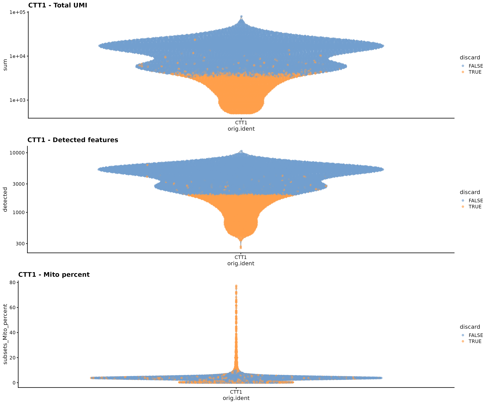
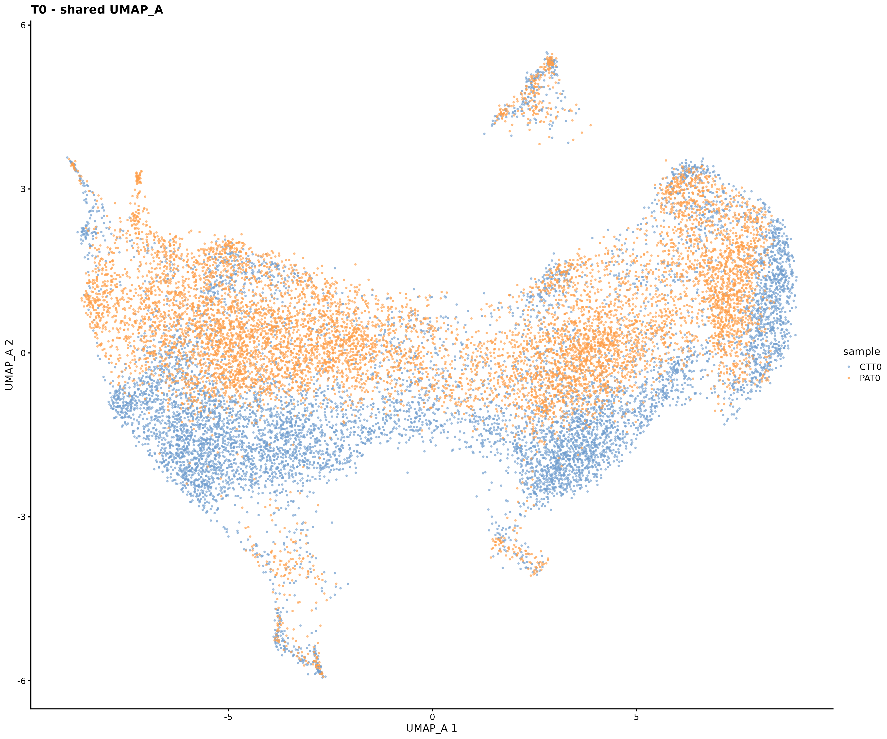
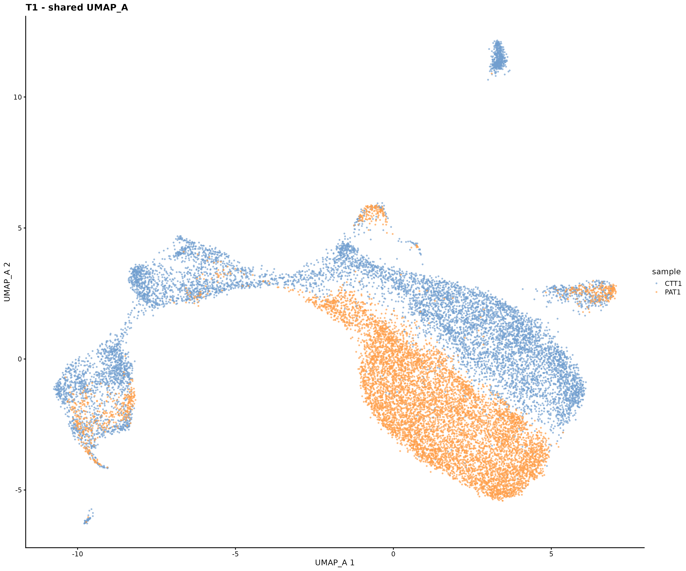
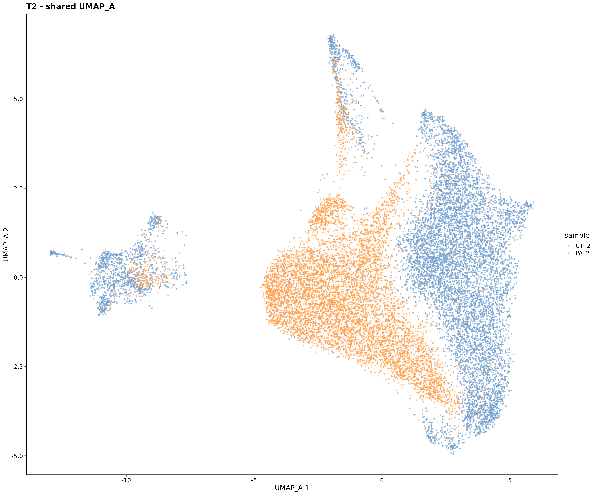
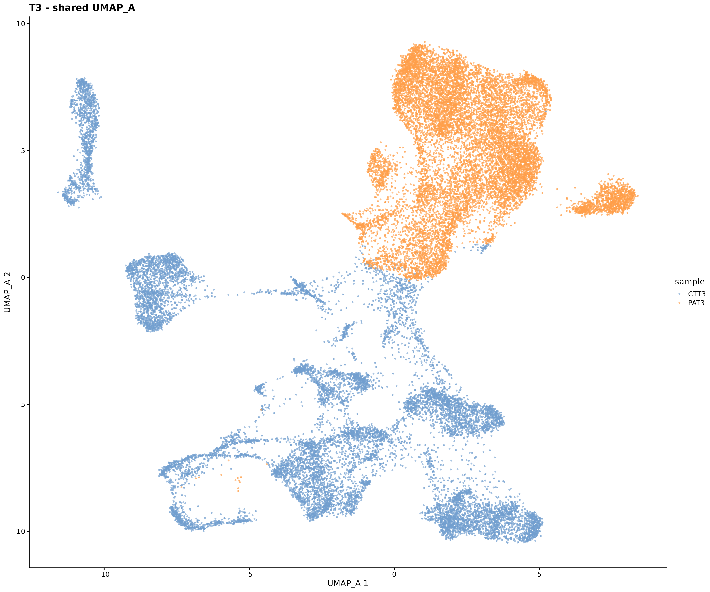
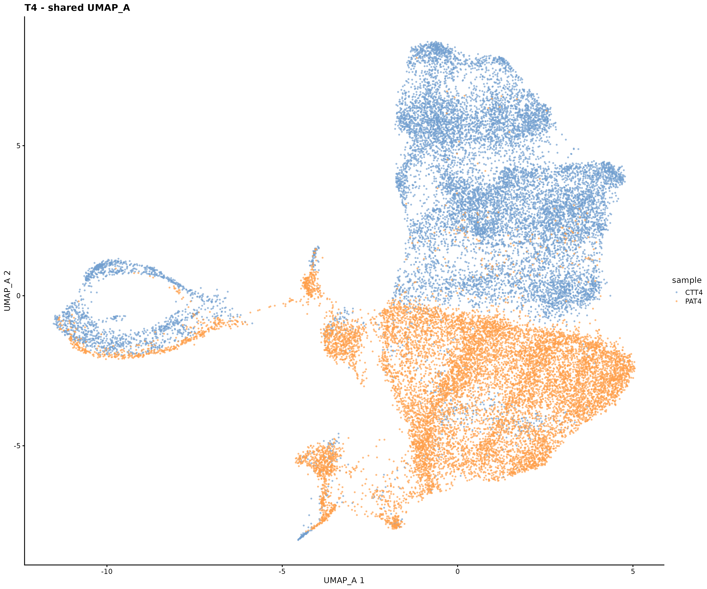

# 1. Pre-processing and shared embeddings

Pre-processing and shared embeddings for single-cell 5′-end RNA-seq (scCAGE-seq, 10x Genomics 5′)
of human brain organoids. Two genotypes, a patient-derived line (PAT) and its isogenic corrected
control (CTT), sampled at five timepoints (T0 = iPSCs, T4 = day 20): ten libraries, one per
genotype × timepoint.

The goal of this step is to get clean cells that are processed in exactly the same way in every
library, and a map per timepoint where CTT and PAT can be compared directly.

## Pipeline

```
Cell Ranger filtered matrix (one per library)
  └─ 01_preprocessing.R      QC → doublets → gene filtering → normalization → cell cycle scores
       └─ 02_shared_embedding.R   CTT + PAT of each timepoint → HVGs → cell cycle regression → PCA → UMAP
```

### 01_preprocessing.R — one function for all the libraries

| Step | What | Why |
|---|---|---|
| QC | discard cells with total UMI < 1500, detected genes < 2000 or mitochondrial reads > 10% | Adaptive MAD thresholds (3 MADs) were tried first and left low-quality cells that formed separate islands on the UMAP. The fixed thresholds were chosen on the distributions: 10% mito removes only the tail of dying cells, < 2000 detected genes is about the first quartile |
| Doublets | `scDblFinder` with the expected doublet rate of each library (`samples.csv`) | the rate is a parameter per sample, because larger libraries have more doublets; the score of every cell is saved to check it |
| Gene filtering | remove mitochondrial, ribosomal and nuclear OXPHOS genes | they dominate the variance without saying much about cell identity |
| Normalization | deconvolution size factors (`quickCluster` + `computeSumFactors`) | robust to the composition differences between libraries |
| Cell cycle | Seurat S / G2M scores, `CC.Difference = S − G2M` | only the scores here: the regression is done later on the two samples together |

Isolated groups of cells were checked before deciding whether to remove them: for example, a small
island in CTT1 with low UMI turned out to be early neurons (STMN2, MAP2, TUBB3, DCC, INA, no stress
genes, lowest doublet score), so it was kept.

### 02_shared_embedding.R — CTT and PAT in the same space

| Step | What | Why |
|---|---|---|
| Joint normalization | `batchelor::multiBatchNorm` | rescales the size factors of the two libraries |
| HVGs | `modelGeneVarByPoisson` blocked by sample, top 10% | genes variable inside each sample, not just between them |
| Cell cycle | `regressBatches(design = ~ CC.Difference, keep = 1)` on both samples together | keeps the log scale; a regression per sample would remove the CTT vs PAT differences |
| PCA | 50 PCs on the corrected HVGs, no scaling | |
| UMAP_A | `n_neighbors = 80`, `min_dist = 0.3` | the map used by all the downstream analyses |
| Batch correction | **none** | the difference between genotypes is what we want to see. With one library per condition, genotype and library cannot be separated: differences are read as descriptive |

## Output

Cells kept (QC-passed singlets) and HVGs of each shared embedding:

| | T0 | T1 | T2 | T3 | T4 |
|---|---|---|---|---|---|
| CTT | 8,741 | 9,366 | 9,326 | 14,053 | 13,330 |
| PAT | 8,930 | 8,457 | 7,253 | 13,517 | 12,538 |
| HVGs | 2,483 | 2,387 | 2,510 | 2,892 | 2,617 |

Doublets removed: 11.7-14.4% of the QC-passed cells per library.

**QC with fixed thresholds** (CTT1): discarded cells in orange.



**Shared UMAP_A, CTT and PAT of the same timepoint in one map** (no batch correction):

| T0 | T1 | T2 |
|---|---|---|
|  |  |  |

| T3 | T4 |
|---|---|
|  |  |

## Run it

From the project folder, with the Cell Ranger output of each library in
`data/<LABEL>/filtered_feature_bc_matrix/` (not included):

```r
source("01_preprocessing/scripts/01_preprocessing.R")
source("01_preprocessing/scripts/02_shared_embedding.R")
```

R 4.x with Seurat, scater, scuttle, scran, scDblFinder, batchelor, ggplot2, gridExtra.

Next: [2. Cell type annotation](../02_celltypist)
