# 2. Cell type annotation with CellTypist

Cell type annotation of single-cell 5′-end RNA-seq (scCAGE-seq, 10x Genomics 5′) of human brain
organoids, with a CellTypist model trained on a public reference: the Kanton et al. 2019 organoid
timecourse (43,498 cells from iPSCs to 4-month organoids, lines h409B2 and H9).

Two genotypes, a patient-derived line (PAT) and its isogenic corrected control (CTT), at five
timepoints (T0 = iPSCs, T3 = day 13, T4 = day 20). The input cells and maps come from
[step 1](../01_preprocessing).

## Pipeline

```
T<t>_joint.rds + Kanton timecourse
  └─ 01_export_for_celltypist.R    raw counts from R to MatrixMarket, genes shared with the reference
       └─ 02_celltypist_annotation.py   train one model, annotate all timepoints
            ├─ 03_celltypist_plots.R    final labels per timepoint, maps, composition
            ├─ 04_marker_check.R        are the labels supported by markers and probabilities?
            └─ 05_tsne.R                t-SNE on the same PCA as the UMAP
```

## Choices

| Choice | What | Why |
|---|---|---|
| Label | Kanton `Cluster` (23 cell types), not the collection stage | the stage says when a cell was collected, not what it is |
| Input | raw counts, scaled to 10,000 per cell and log1p in Python | what CellTypist requires; cell cycle-regressed values cannot be used here |
| Model | one logistic regression classifier per type (one-vs-rest), trained once on the genes shared by the reference and all samples; 2,644 features selected | the same model at every timepoint, so that labels can be compared |
| Majority voting | off | it would relabel the cells by cluster; here each cell keeps its own label |
| T0-T2 | a cell is stem if its highest stem probability is ≥ 0.1; Unassigned if no type reaches 0.5; the 18 organoid-only types are grouped | stem cells are expected at these stages; the threshold was chosen from the marker analysis |
| T3-T4 | best match, no stem threshold, every Kanton type with its own colour; Unassigned below 0.4 | at day 13-20 forcing stem labels would inflate a type that has almost disappeared |

The two Unassigned thresholds are a declared choice. The reference jumps from neuroepithelium to
1-month organoids, and at day 13-20 many CTT cells sit between these stages, with medium probabilities
on neighbouring types:

| Sample | Cells | No type ≥ 0.5 | Unassigned in the labels |
|---|---|---|---|
| CTT3 | 14,053 | 3,073 (21.9%) | 2,865 (20.4%) |
| PAT3 | 13,517 | 635 (4.7%) | 581 (4.3%) |
| CTT4 | 13,330 | 1,736 (13.0%) | 1,542 (11.6%) |
| PAT4 | 12,538 | 124 (1.0%) | 112 (0.9%) |

Going from 0.5 to 0.4 recovers only part of these cells, and below 0.4 no type describes the cell
well, so the threshold is not lowered further. These cells are scattered on the map rather than
forming an island of their own.

## Output

**Composition of the 10 samples.** Every cell counts once, whatever its number of UMIs. With one
library per condition, differences are descriptive.

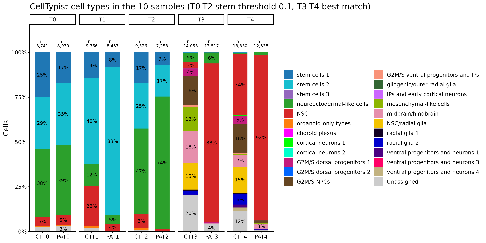

**Shared UMAP_A, CTT and PAT in one panel.**

| T0 | T1 | T2 |
|---|---|---|
| 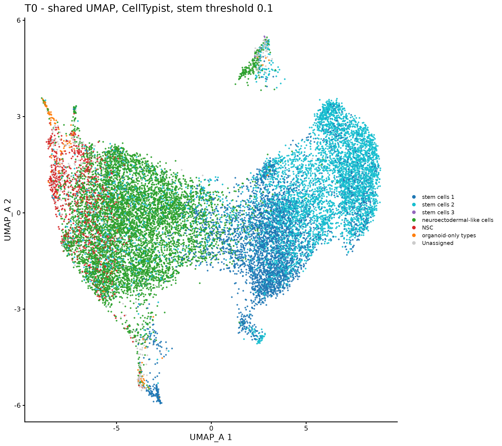 | 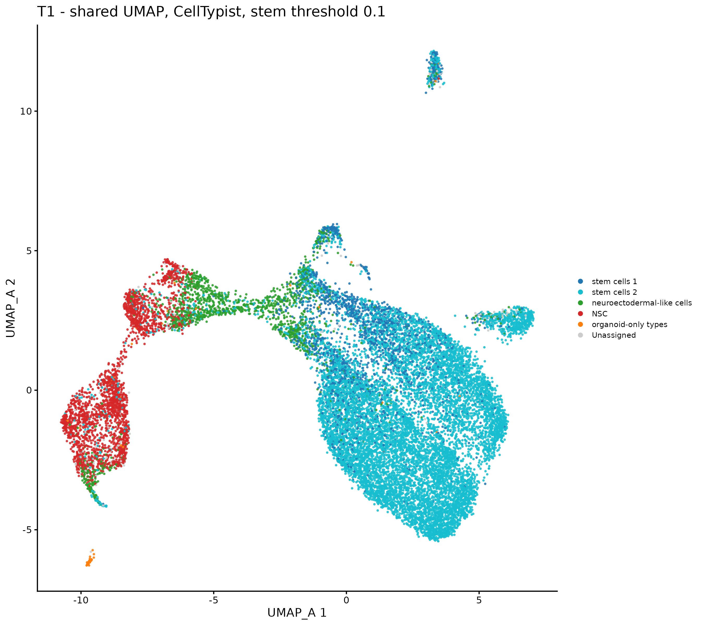 | 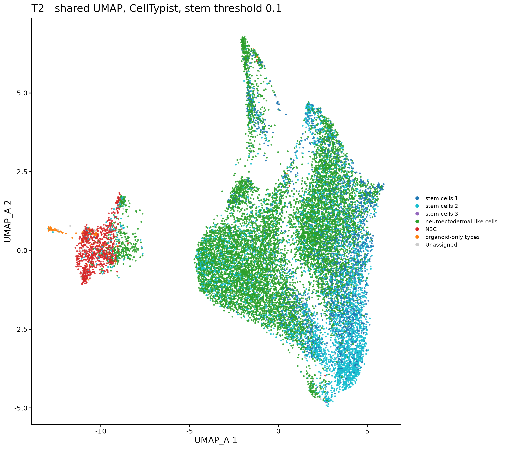 |

| T3 | T4 |
|---|---|
| 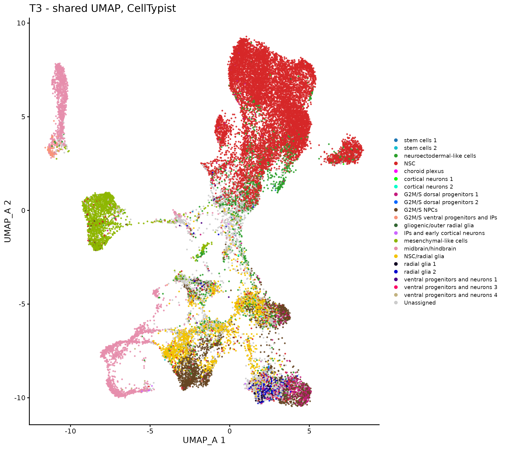 | 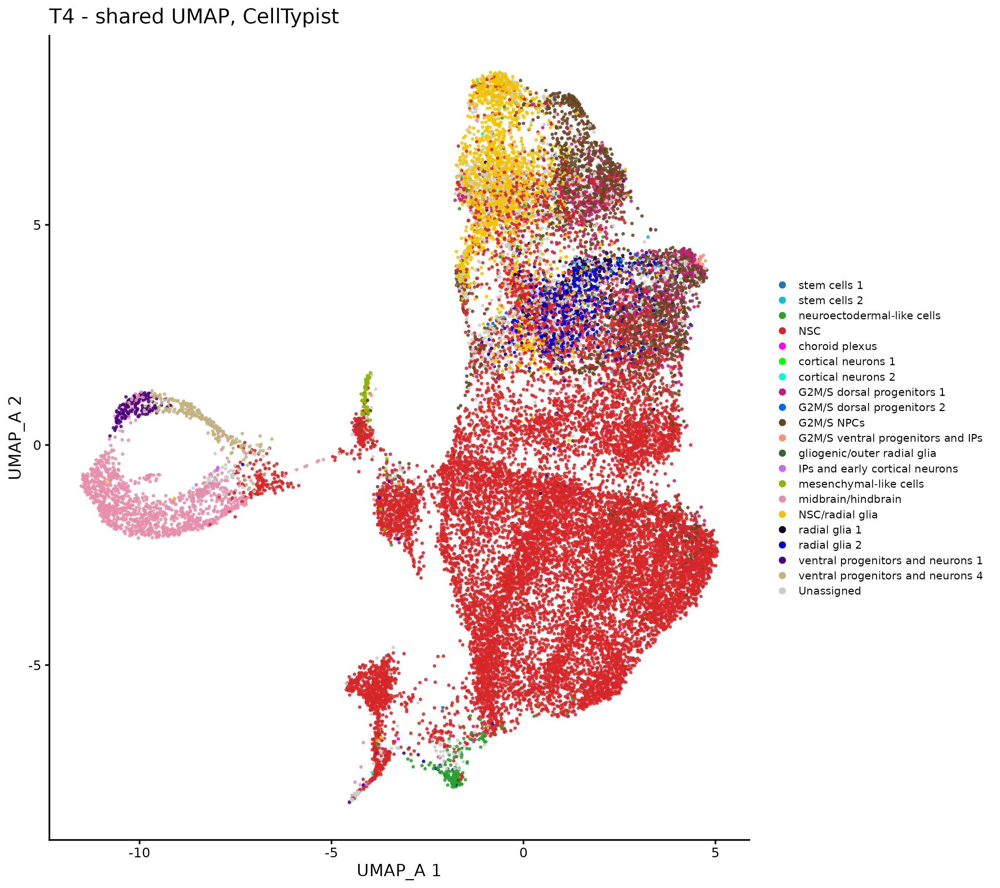 |

**t-SNE on the same PCA, CTT | PAT.** Local neighbours are kept; distances between islands and their
sizes are not meaningful.

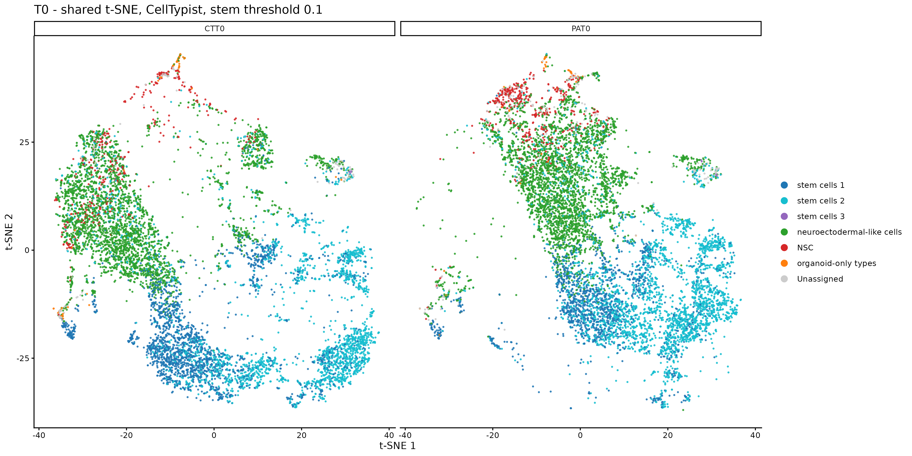
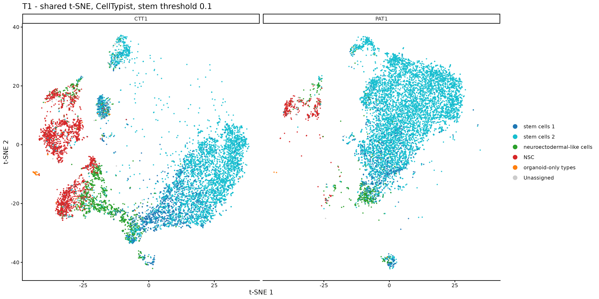
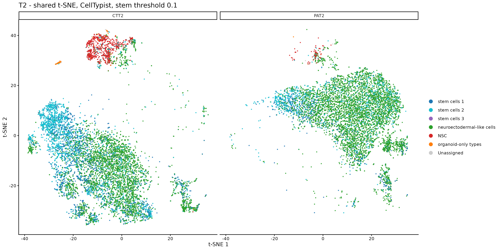
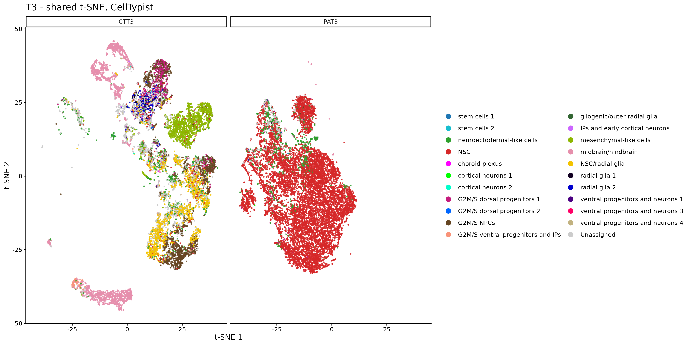
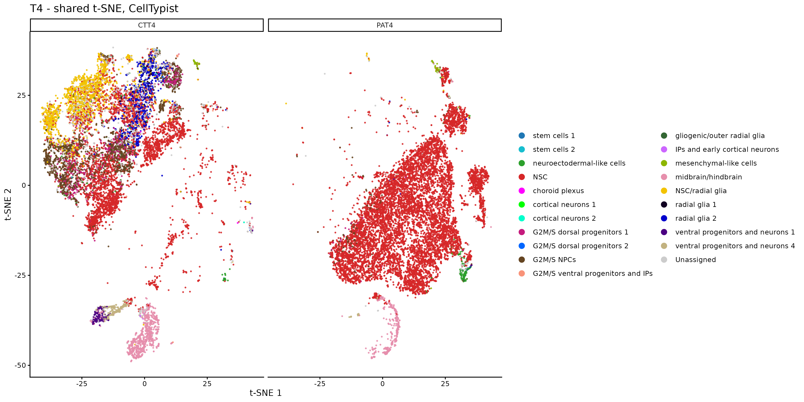

## Run it

From the project folder, with the Kanton et al. 2019 timecourse in
`data/timecourse_human_singlecells_GRCh38.rds` (not included) and the output of step 1:

```r
source("02_celltypist/scripts/01_export_for_celltypist.R")
```
```bash
pip install -r requirements.txt
python 02_celltypist/scripts/02_celltypist_annotation.py
```
```r
source("02_celltypist/scripts/03_celltypist_plots.R")
source("02_celltypist/scripts/04_marker_check.R")
source("02_celltypist/scripts/05_tsne.R")
```

R with SingleCellExperiment, Seurat, Matrix, scater, ggplot2.

Next: [3. Trajectory](../03_trajectory)
