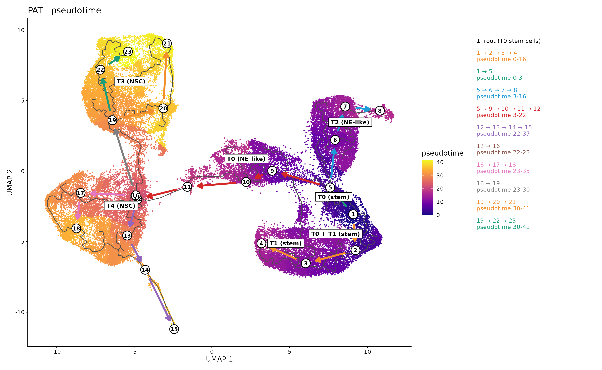
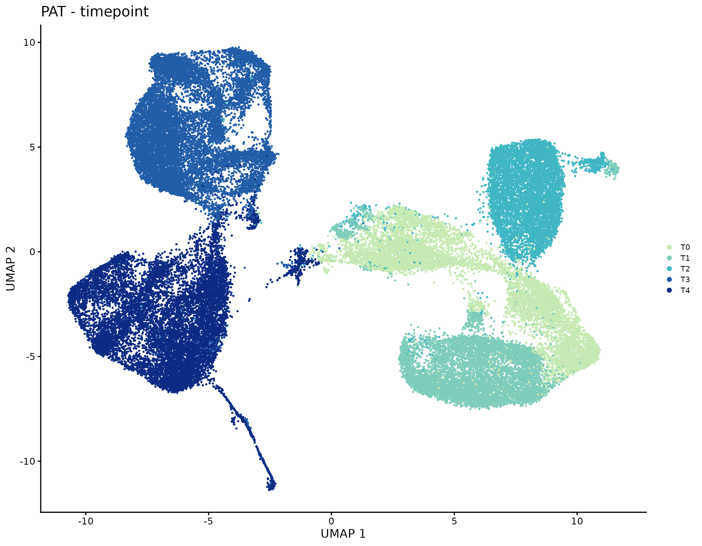
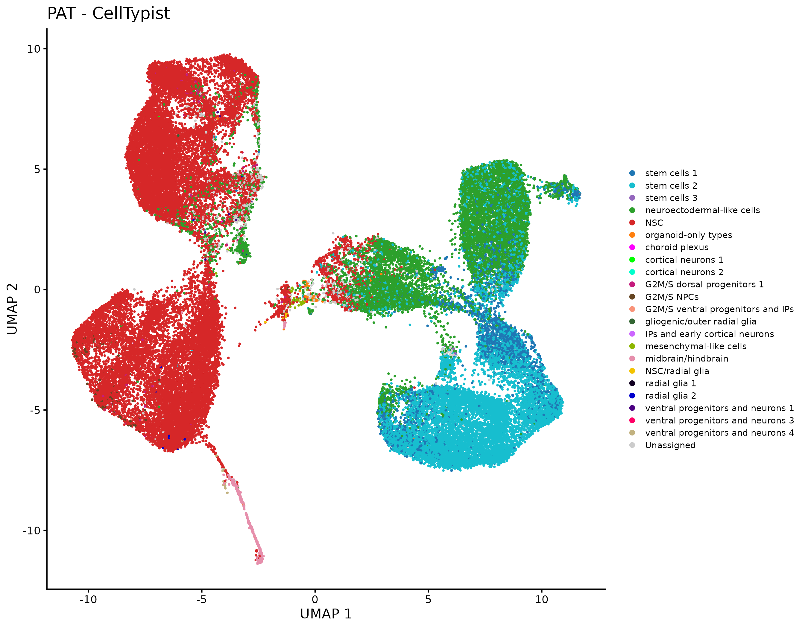
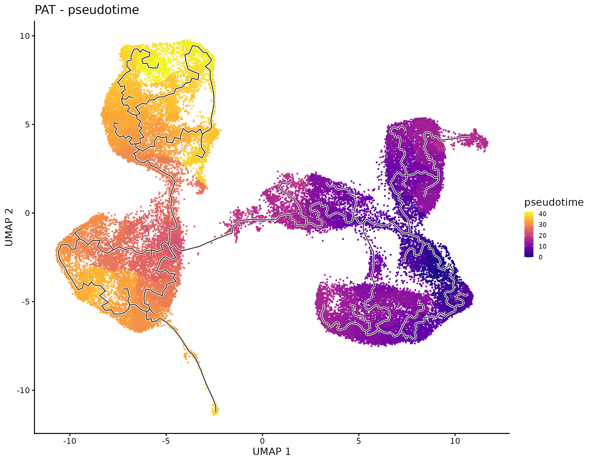
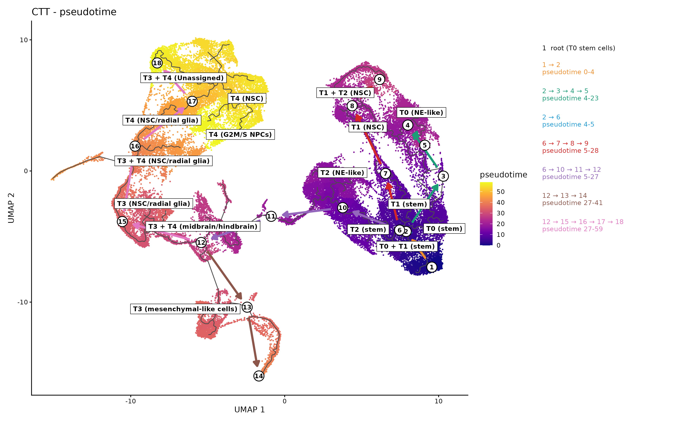
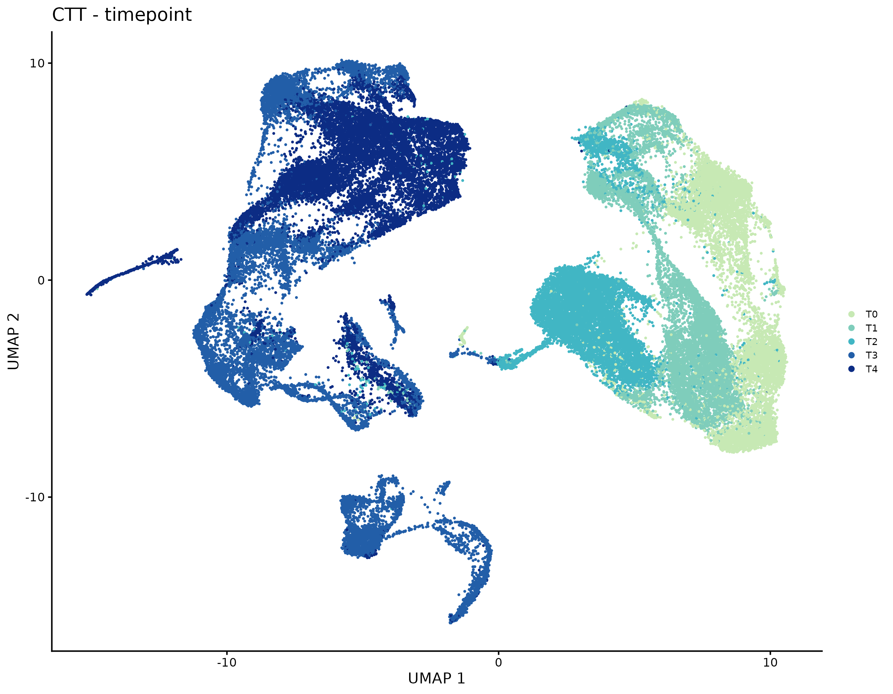
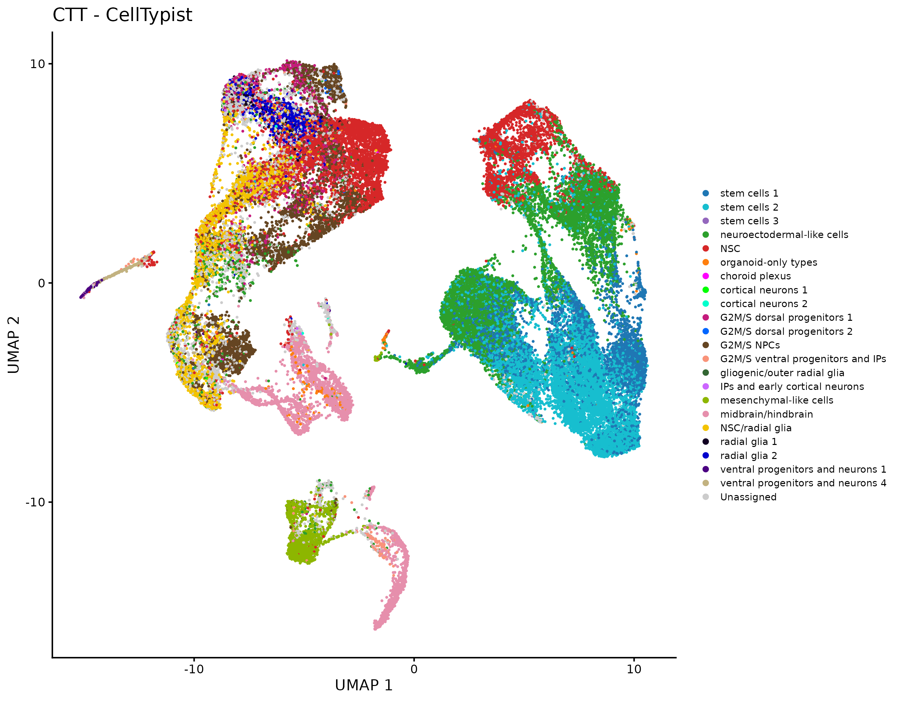
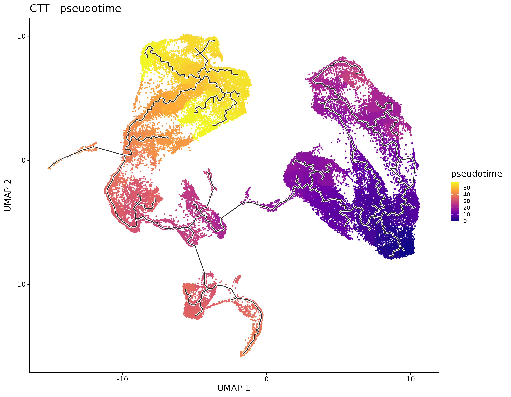

# 3. Trajectory and pseudotime with monocle3

One map per genotype with all five timepoints, a principal graph, a pseudotime from the T0 stem
cells, and a numbered path that makes the graph readable. Cells, counts and labels come from
[step 1](../01_preprocessing) and [step 2](../02_celltypist).

## Pipeline

| Step | What | Why |
|---|---|---|
| Merge | all the QC-passed cells of one genotype, T0 to T4, no integration: CTT 54,816 cells, PAT 50,695 cells | one object per genotype, so the pseudotime runs over the days |
| Map | NormalizeData, 2,000 variable genes (vst), ScaleData, PCA (30 PCs), UMAP | the Seurat workflow of the Sanbomics monocle3 tutorial |
| Graph | `cluster_cells`, `learn_graph(use_partition = FALSE)` | one connected trajectory, without separating the days into partitions |
| Root | the graph node closest to most of the T0 stem cells (CellTypist stem cells 1 + 2), fixed in the code | reproducible, instead of choosing it by clicking on the map |
| Maps | drawn with ggplot from the table of the cells | small legend and no outline on the cells, so the map stays the main element |

Timepoint and library are the same thing here (n = 1 per sample), so part of the separation between
days can be technical. CTT and PAT are two different maps: pseudotime values compare days inside a
genotype, not CTT with PAT.

## The numbered path

The principal graph has hundreds of nodes. Step 8 of the script reduces it to a few numbered steps,
computed from the data with no manual placement:

- **Pseudotime of a node**: distance along the graph from the root, the same quantity `order_cells` gives to the cells.
- **Loops**: `learn_graph` closes loops by default, so only the shortest-path tree from the root is used for the numbering. The grey graph on the map stays complete.
- **Branches**: at each branch point the child that reaches furthest is always kept, and a side branch is drawn only if it goes at least 20% of the maximum pseudotime beyond the branch point. This way a long branch is never cut into pieces.
- **Numbers**: root, branch points and ends, plus one node every maximum / 8 of pseudotime, numbered branch by branch.
- **Boxes**: monocle3 clusters, named with the days holding at least 20% of their cells and the most frequent CellTypist label.

## Output

**PAT**



| Timepoint | CellTypist | Pseudotime |
|---|---|---|
|  |  |  |

**CTT**



| Timepoint | CellTypist | Pseudotime |
|---|---|---|
|  |  |  |

**Pseudotime per timepoint**, median (5th-95th percentile):

| | T0 | T1 | T2 | T3 | T4 |
|---|---|---|---|---|---|
| CTT | 12.8 (0.2-22.0) | 8.7 (2.4-26.6) | 15.3 (9.2-22.3) | 35.9 (26.8-57.3) | 52.2 (26.3-58.0) |
| PAT | 8.1 (1.3-16.3) | 11.7 (7.2-16.7) | 11.6 (5.9-16.6) | 35.1 (29.1-40.9) | 28.9 (23.4-34.9) |

Pseudotime is a position along a branch, not a clock: a later day can have a lower median when its
cells sit on a shorter branch.

## Run it

From the project folder, after steps 1 and 2. Set `geno` in Step 0 of the script (first `"CTT"`, then
`"PAT"`) and run the steps one by one; Step 8 can also be run alone after Step 0.

```r
source("03_trajectory/scripts/monocle3_trajectory.R")
```

R with monocle3, Seurat, SingleCellExperiment, igraph, ggplot2, ggrepel, patchwork.
