# 4. Transcribed cis-regulatory elements with SCAFE

Single-cell 5′-end RNA-seq captures where transcription starts. [SCAFE](https://github.com/chung-lab/SCAFE)
uses this signal to define transcribed cis-regulatory elements (tCREs) and count them in each cell:
proximal tCREs (promoters) and distal tCREs (enhancer candidates).

Here the cells are then described **only by their regulatory elements**: no genes and no cell identities
enter the maps. The question is how CTT and PAT organize at each timepoint when only tCRE usage is
considered, and whether all, distal and proximal elements tell the same story.

## Pipeline

### 01_run_scafe.sh: from the BAM files to the tCRE x cell matrices

| Step | What | Why |
|---|---|---|
| `workflow.sc.solo` | per library: 5′ ends from the BAM, removal of strand invasion artefacts, TSS clusters | the first part of the workflow recommended for multiple libraries |
| `workflow.cm.aggregate` | pools the signal of the ten libraries, clusters it, filters the TSS clusters with a logistic regression, defines and annotates the tCREs | more sensitive detection, and one common set: the tCRE IDs are the same in every sample |
| `tool.sc.count` | tCRE × cell UMI matrix per library, on the common set | the matrices can be put together, row by row |

All SCAFE defaults, genome `hg38.gencode_v32`. Proximal = within 500 nt of an annotated gene TSS. The
filter uses the pre-trained SCAFE model (iPSC + ATAC): no matched ATAC was available to train a new one.
The libraries of T0-T2 went through `sc.solo` in an earlier run, with the same options and BAM files; the
script shows all ten together.

**Common set: 125,956 tCREs** (77,897 distal, 48,059 proximal).

### 02_tCRE_embedding.R: maps built on the tCREs

The same steps as the gene-based [shared embedding](../01_preprocessing), so that only the features change.
Repeated for each timepoint (CTT + PAT) and each set (all, distal, proximal):

| Step | What |
|---|---|
| Normalization | size factors on the tCRE counts of each sample (`quickCluster` + `computeSumFactors`), then `multiBatchNorm` |
| Variable tCREs | `modelGeneVarByPoisson` blocked by sample, top 10% |
| Cell cycle | `CC.Difference` regressed on both samples together (`regressBatches`, `keep = 1`) |
| Map | PCA (50 PCs, no scaling), UMAP (`n_neighbors = 80`, `min_dist = 0.3`), no batch correction |
| Colours | activity = log2(UMI of the set / gene size factor + 1), and tCREs detected per cell |

Positions and shapes cannot be compared between maps, because UMAP chooses the arrangement. The structure can:
which cells stay close, whether CTT and PAT form separate or mixed regions, how many islands there are.

With one library per genotype × timepoint, genotype and library effects cannot be separated, so the maps are
read as descriptive.

## Output

CTT in blue, PAT in orange, each with its own scale on the same value range (light = low, dark = high). In each
figure, activity on top and tCREs detected below.

| | All tCREs | Distal | Proximal |
|---|---|---|---|
| **T0** | 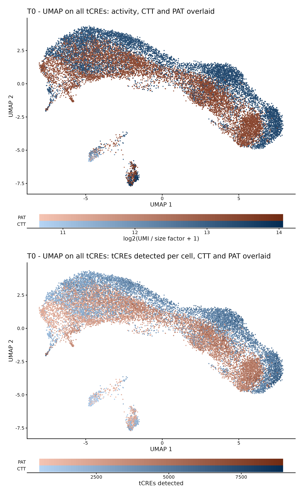 | 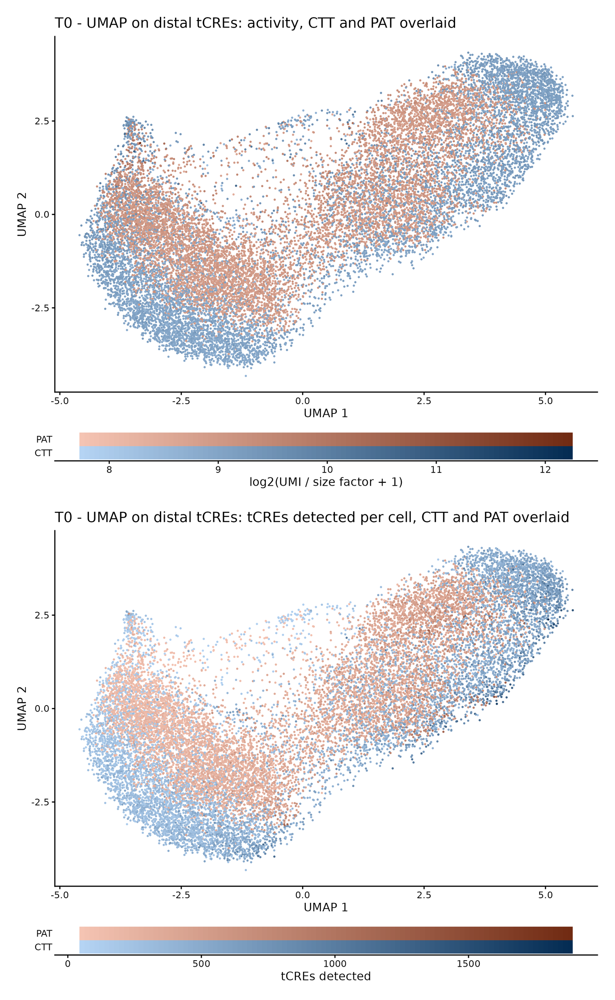 | 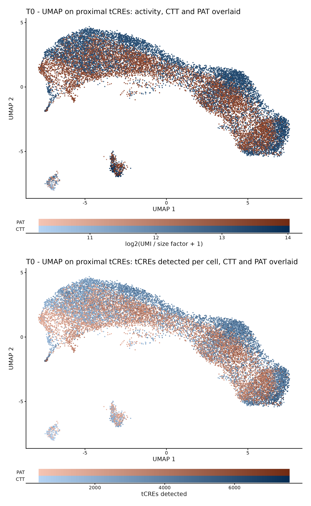 |
| **T1** | 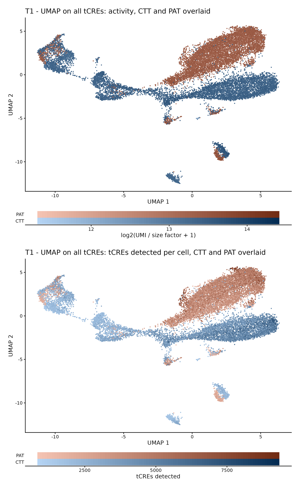 | 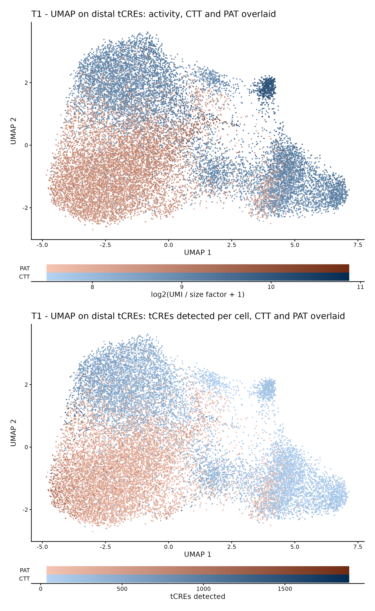 | 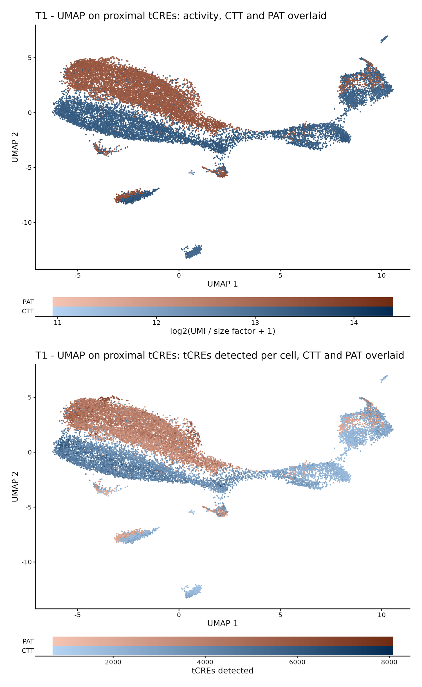 |
| **T2** | 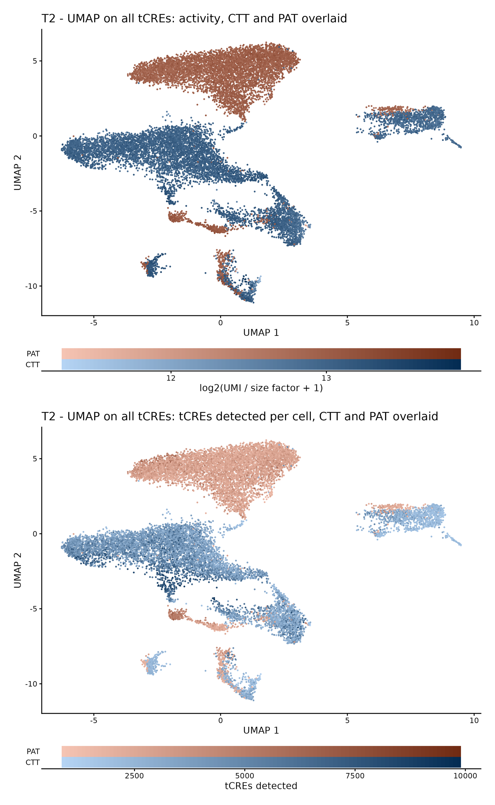 | 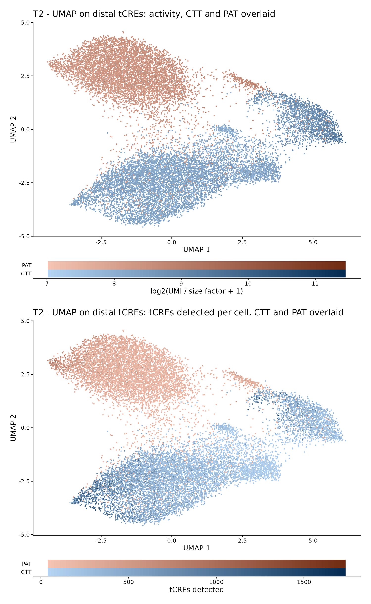 | 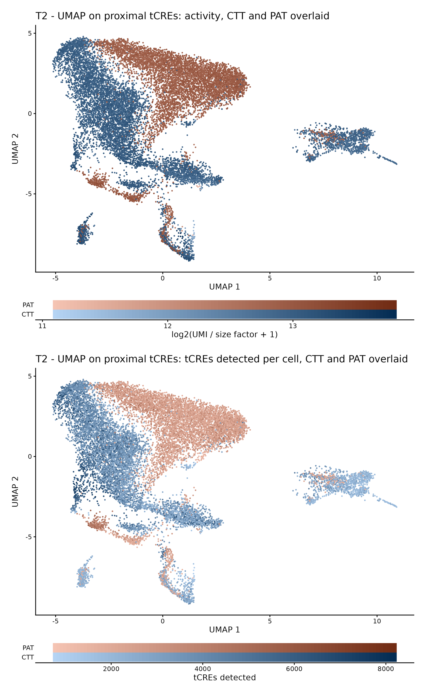 |
| **T3** | 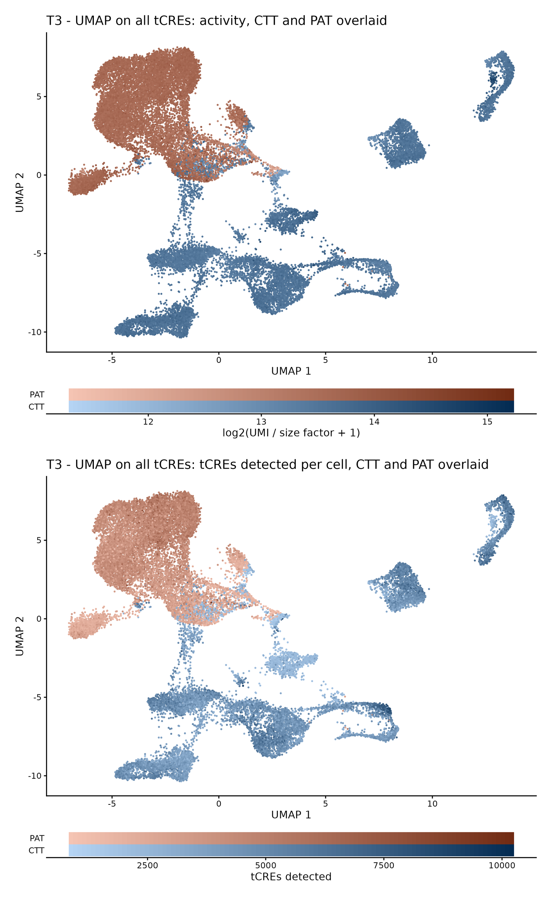 | 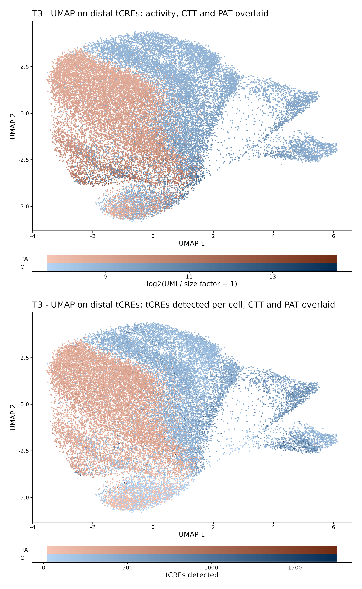 | 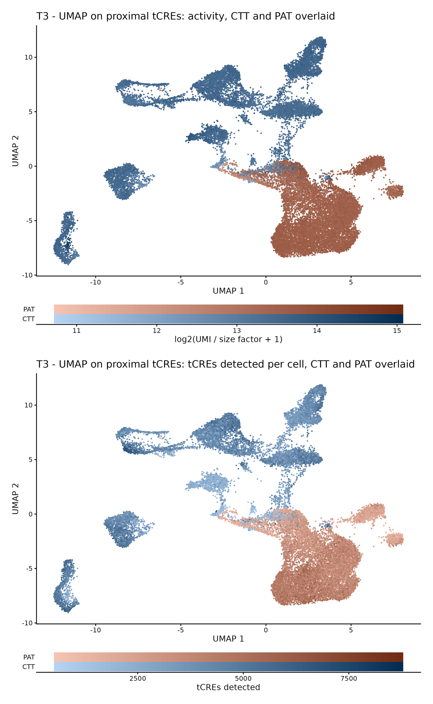 |
| **T4** | 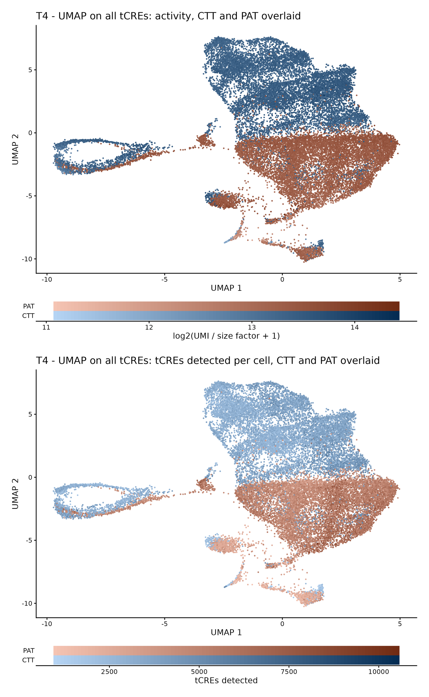 | 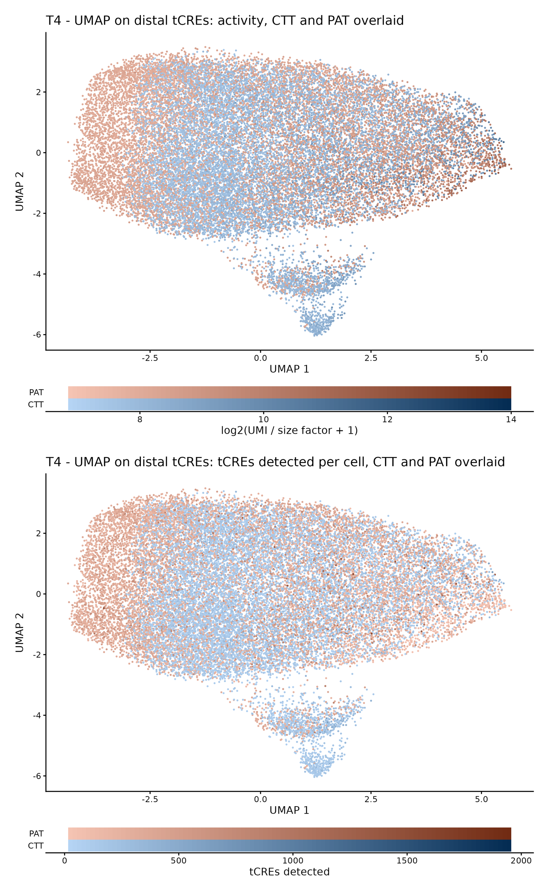 | 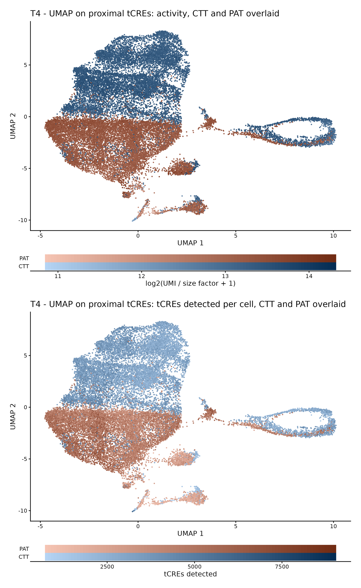 |

## Run it

From the project folder, with SCAFE installed and the BAM files in `data/<LABEL>/` (not included), after step 1:

```bash
nohup bash 04_tCRE_SCAFE/scripts/01_run_scafe.sh > results/scafe_all10.log 2>&1 &
```
```bash
nohup Rscript 04_tCRE_SCAFE/scripts/03_run_all_timepoints.R > results/tCRE_embedding.log 2>&1 &
```

R with Matrix, SingleCellExperiment, scater, scran, batchelor, ggplot2, patchwork.
